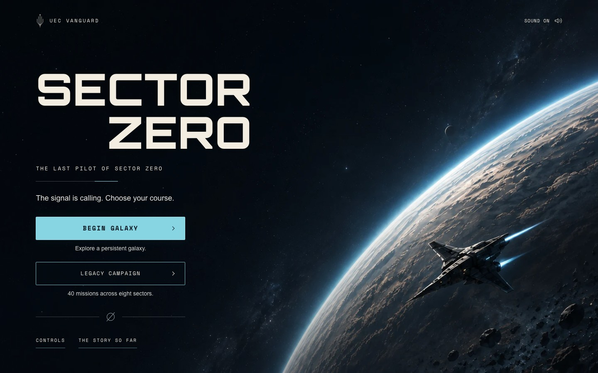
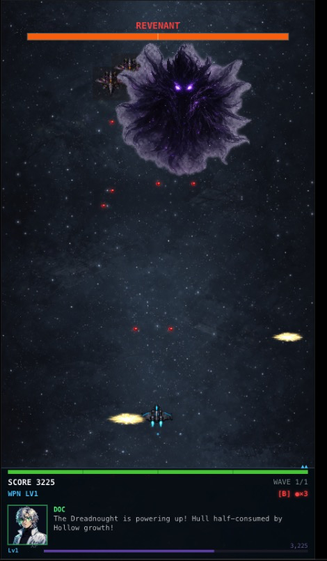
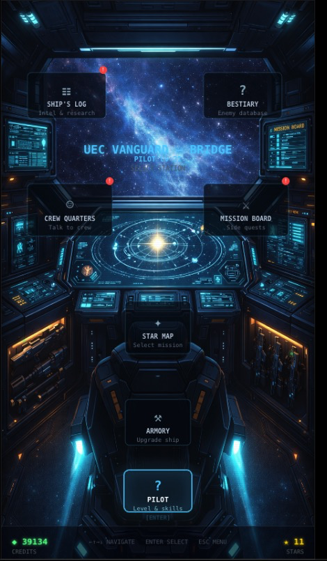

# Sector Zero

**Answer the signal. Explore the frontier. Face the Hollow.**

[](https://colorpulse6.github.io/sector-zero/)

<p align="center">
  <a href="https://colorpulse6.github.io/sector-zero/"><strong>Play in your browser</strong></a>
  &nbsp; · &nbsp;
  <a href="https://colorpulse6.github.io/sector-zero/site/">Explore the website</a>
  &nbsp; · &nbsp;
  <a href="https://colorpulse6.github.io/sector-zero/site/news/">Read the mission logs</a>
</p>

A browser-based space adventure set in 2847. Travel through a persistent galaxy, step into frontier settlements, and take on the work that changes them. The **UEC Vanguard** and the mystery of the Hollow connect the journey.

Choose **Begin Galaxy** for the developing persistent-world experience. **Legacy Campaign** preserves the original 40 missions across eight sectors.

Our direction is simple: **travel → explore → improve a colony → undertake local work → return to lasting consequences**. We are building that loop in Ashfall first, then expanding one finished place at a time.

## From the game

<table>
  <tr>
    <td width="50%" align="center"><strong>Space combat</strong></td>
    <td width="50%" align="center"><strong>The Vanguard</strong></td>
  </tr>
  <tr>
    <td><a href="site/public/images/modes/boss-fight.png"></a></td>
    <td><a href="site/public/images/modes/cockpit.png"></a></td>
  </tr>
</table>

*In-game captures. Select an image to view it at full size. The opening screen above uses illustrative key art.*

## Combat and exploration

- **Space combat** — Weave through enemy formations and take on the bosses guarding eight sectors.
- **First-person combat** — Explore interiors and face the threats around the next corner.
- **Turret defense** — Track incoming fighters from the gunner's seat.
- **Multi-phase missions** — Move between combat modes as a mission unfolds.

## A world between missions

- **Ashfall colony** — Descend from the Atlas, walk the outpost, speak with the Overseer and build a Solar Array, Mine, Habitat Module, Farm and Water Purifier. Construction takes world cycles; finished buildings appear on the next descent.
- **Settlement development** — Power the Mine for repeatable metal, then provide housing, food and water. Settlers arrive one per world cycle while happiness is over 60 and housing is free. Management explains power, build restrictions and the next cycle. Galaxy trade, resupply and failure recovery remain unfinished.
- **Pilot progression** — Earn XP, develop your skills, upgrade your loadout, and build out your codex.
- **Keyboard and touch** — Use mode-specific controls on desktop or on-screen controls on mobile. In first-person missions, press **E** or tap **Interact** to collect nearby supplies and talk; **Z / Space** or **Fire** shoots. Colony walks retain **Z / Interact**.
- **Saved progress** — Continue your journey with saves stored locally in your browser.

The streamlined game retains space combat, turret defense, first-person missions and colony exploration, with multi-phase operations connecting them. Ground run-and-gun and ship boarding have been removed.

To grow Ashfall, open **Manage Colony** from the Atlas or landing pad. On a fresh run, start with **Solar Array → Mine**, then build housing, food and water as metal arrives. Surveys, expeditions, travel and operations advance construction and population; waiting on the screen does not. The current early economy is slow and a failed one-time sortie can still block the initial Mine. Recovery and pacing are the next required work.

See the [master roadmap](docs/ROADMAP.md) for current implementation status, owners and completion gates. The feature branch can be ahead of the public build; pushing a branch does not deploy the game.

## Run locally

Use **Node.js 20** and enable Corepack for the project's Yarn version.

```bash
git clone https://github.com/colorpulse6/sector-zero.git
cd sector-zero
corepack enable
cd game
yarn install
yarn dev
```

Open [localhost:3000](http://localhost:3000) to play.

To run the companion site, open another terminal from the repo root:

```bash
cd site
yarn install
yarn dev --port 3001
```

Open [localhost:3001](http://localhost:3001) for the website.

## Built with

**Next.js 15 · React 19 · TypeScript · HTML5 Canvas · Tailwind CSS**

The game renders on a 480 × 854 canvas. The game and companion site are independent Next.js apps, exported as static files and deployed together to GitHub Pages.

## Contributing

See [CONTRIBUTING.md](CONTRIBUTING.md) for setup, contribution guidelines, and the pull request process.

## License

[MIT](LICENSE) — Copyright (c) 2026 Nichalas Barnes
